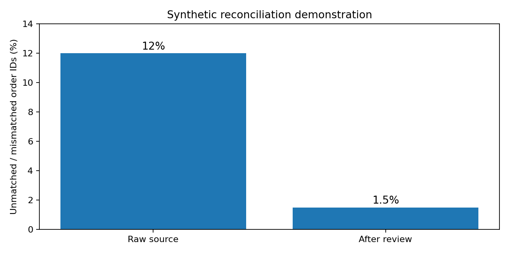

# Retail Operations Analytics | SQL · Python · Reconciliation · BI

> **Synthetic, educational reconstruction.** This repository uses generated records and simulated outcomes. **No original employer/client data, source code, confidential documents, or historical deliverables are included.** The demonstration illustrates retail analytics techniques; it is not independent evidence that any past contract achieved these metrics.

## Business context

An omnichannel retailer receives online **Shopify** and offline **POS** sales and corresponding invoice feeds. The exercise demonstrates how to standardise retail transactions, detect invoice inconsistencies, organise reporting datasets, and surface operational KPIs.

## Reproducible synthetic scenario

| Metric | Simulation |
|---|---:|
| Orders | 750,000 |
| Before: affected orders | 90,000 (12.0%) |
| After simulated review: affected orders | 11,250 (1.5%) |
| Illustrative weekly reporting effort | 8 hours → 2 hours (75%) |

The reporting-hours comparison is a **scenario assumption**, not measured by generated transaction records. The synthetic exception-review process is illustrative, **not** a template for overwriting financial documents.



## Project workflow

```text
Shopify / POS order data + invoice feed
  -> harmonised transaction model
  -> invoice reconciliation at order grain
  -> missing / duplicate / amount exception categories
  -> simulated, labelled review and residual exceptions
  -> monthly, channel and SKU aggregates
  -> HTML demo dashboard / Power BI-ready CSVs
```

## Quick start

Requires Python 3.10+ (recommended).

```bash
python -m venv .venv
# macOS/Linux: source .venv/bin/activate
# Windows: .venv\Scripts\activate
pip install -r requirements.txt
python build_demo.py
python run_analysis.py
```

`build_demo.py` deterministically generates the **complete 750K-row dataset** under `data/` using a fixed seed, along with report outputs in `outputs/`. The large generated CSVs are excluded from Git to keep the repository lightweight. Small examples are committed under `data/sample/`.

**Open:** `outputs/retail_dashboard.html` for an offline demonstration.

## Structure

```text
├── build_demo.py                 # deterministic generator & KPI builder
├── run_analysis.py               # independent reconciliation replay
├── requirements.txt
├── data/
│   ├── sample/                   # small sample CSVs
│   ├── products.csv              # synthetic product dimension
│   └── inventory_snapshot.csv   # illustrative inventory snapshot
├── sql/
│   └── mysql_reconciliation.sql  # reconciliation and channel KPIs (MySQL 8+)
├── outputs/                      # demo dashboard, KPIs, summary and chart
└── docs/INTERVIEW_PLAYBOOK.md    # walkthrough, edge cases, interview prep
```

## What the analysis tests

- **Data grain:** invoice records must be evaluated at `order_id` grain before joining to order facts; naive 1-to-many joins inflate totals.
- **Exception rules:** missing invoice, duplicate invoice and mismatched amount are reported as distinct categories.
- **Metrics:** exception rate = distinct affected orders / eligible orders.
- **Reporting:** aggregate net sales by channel/month/SKU and separate product contribution from true net profit.
- **Inventory:** inventory is a separate snapshot, not an additive column on order transactions.
- **Quality:** reruns are deterministic; reconcile aggregate totals to source order counts.

## Limitations and responsible interpretation

- Simulated after-review data is generated programmatically and does not document actual approved invoice corrections. In production, every financial adjustment needs authorisation, source-of-truth evidence, and audit traceability.
- One order = one order record in this demonstration; real systems can have order lines, split invoices, returns, credit notes and tax complexities.
- Demo `contribution` subtracts **product costs only**; it does not include shipping, marketing, taxes or fixed costs.
- The supplied HTML is a portable dashboard mock-up. It is **not** a native `.pbix` Power BI project. The reporting data can be imported into Power BI to build one.

## Portfolio presentation

Suggested description: *“Created a reproducible synthetic omnichannel retail analytics case study to demonstrate SQL reconciliation, Python/Pandas reporting, exception handling, and BI-oriented datasets.”* Do not describe this repository as an original confidential client's deliverables.
